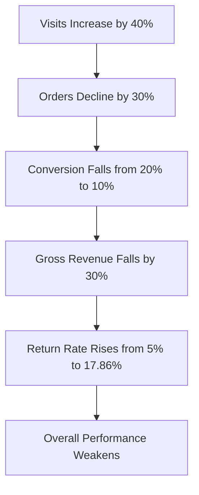
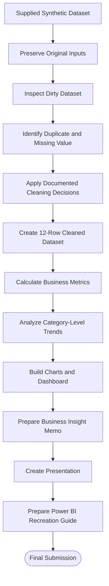

# 📊 Campus Store Performance Analytics — Final Submission

<p align="center">
  <strong>Understanding the relationship between customer visits, orders, revenue, and returns.</strong>
  <br/>
  A reproducible business analytics project using a fictional campus store dataset from CareerSwami.
</p>

<p align="center">
  
  
  
  
</p>

---

## 📖 Project Overview

**Campus Store Performance Analytics** is a reproducible business analytics project that investigates the performance of a fictional campus store using the CareerSwami synthetic dataset.

The project examines how customer visits, orders, gross revenue, and returns change across three product categories over four weeks.

Its central business question is:

> **Why can visits increase while business performance weakens, and what does the category-level evidence show?**

The analysis demonstrates why increasing traffic does not necessarily indicate improving business performance. Conversion, revenue generation, average order value, and returns must also be considered.

The submission includes cleaned data, metric calculations, a browser-based dashboard, evidence logs, a business insight memo, a presentation, and a Power BI recreation guide.

## 🎯 Project Objectives

- Analyze weekly campus store performance.
- Compare visits, orders, gross revenue, and returns.
- Identify category-level performance changes.
- Investigate the relationship between traffic and conversion.
- Document data-quality issues and cleaning decisions.
- Calculate business KPIs using consistent aggregation methods.
- Communicate findings through dashboards and business reporting.
- Make the analysis reproducible and auditable.

---

## 🚀 Start Here

Follow this order to review the final submission.

| Step | File / Folder | What to Review |
|---|---|---|
| 1 | `06_Final/Business_Insight_Memo.pdf` | Read the business findings and recommendations |
| 2 | `04_Dashboard/index.html` | Explore the interactive browser dashboard |
| 3 | `04_Dashboard/` chart assets | Keep the PNG charts beside the HTML dashboard |
| 4 | `02_Data/campus_store_cleaned.csv` | Inspect the final cleaned dataset |
| 5 | `05_Evidence/` | Review data cleaning and transformation evidence |
| 6 | `07_PowerBI/PowerBI_Build_Guide.md` | Recreate the native Power BI report |

**Important:** The Power BI folder contains a build guide and DAX measures. The native `.pbix` file must still be created and saved as part of the final Power BI work.

---

## 📌 Business Question

Why can customer visits increase while business performance weakens?

The analysis examines four connected dimensions:

1. **Traffic:** Are more customers visiting the store?
2. **Conversion:** Are visits resulting in orders?
3. **Revenue:** Is the store generating more gross revenue?
4. **Returns:** Are more orders being returned?

Looking at visits alone can hide declining conversion and weakening revenue performance.

---

## 📦 Dataset Overview

The project uses a fictional, synthetic campus store dataset supplied through CareerSwami.

### Dataset grain

Each observation represents:

**One week × one product category**

| Attribute | Value |
|---|---:|
| Weeks | 4 |
| Product categories | 3 |
| Expected canonical records | 12 |
| Dirty input records | 13 |
| Cleaned records | 12 |

### Product categories

- Books
- Stationery
- Accessories

### Canonical dataset totals

<grid columns={2} gap={3}>
  <grid-item>
    <box border radius="lg" padding={3} gap={1}>
      <text color="secondary" weight="medium" size="sm">Total visits</text>
      <title size="2xl" color="default" tabularNums>3,060</title>
    </box>
  </grid-item>
  <grid-item>
    <box border radius="lg" padding={3} gap={1}>
      <text color="secondary" weight="medium" size="sm">Total orders</text>
      <title size="2xl" color="default" tabularNums>624</title>
    </box>
  </grid-item>
  <grid-item>
    <box border radius="lg" padding={3} gap={1}>
      <text color="secondary" weight="medium" size="sm">Gross revenue</text>
      <title size="2xl" color="default" tabularNums>₹80,550</title>
    </box>
  </grid-item>
  <grid-item>
    <box border radius="lg" padding={3} gap={1}>
      <text color="secondary" weight="medium" size="sm">Total returns</text>
      <title size="2xl" color="default" tabularNums>43</title>
    </box>
  </grid-item>
</grid>

---

## 🧹 Data Cleaning and Quality Decisions

The project preserves the supplied input files and documents the transformations used to produce the canonical dataset.

### Original data

| File | Description | Records |
|---|---|---:|
| `campus_store_raw_preserved.csv` | Untouched supplied canonical raw source | As supplied |
| `campus_store_dirty_input.csv` | Untouched dirty input | 13 |
| `campus_store_cleaned.csv` | Final cleaned dataset | 12 |

### Cleaning operations

| Issue | Action | Reason |
|---|---|---|
| Duplicate record | Removed one duplicate Week 1 Books row | Enforce one record per week and category |
| Missing orders | Restored Week 2 Stationery orders to 96 | Exact matching value available in supplied canonical raw source |
| Record count | Reduced from 13 to 12 | Achieve the expected analytical grain |

### Duplicate handling

The duplicate was identified using the composite key:

```text
(week, category)
```

One duplicate Week 1 Books record was removed.

### Missing-value handling

The Week 2 Stationery orders field was blank in the dirty input.

The value was restored to `96` by looking up the corresponding record in the supplied canonical raw source.

### Important source-instruction decision

The supplied project instructions present two possible treatments for the missing Week 2 Stationery orders value:

- Restore the value using the supplied canonical raw source.
- Retain the missing value as unknown under a more conservative treatment.

This submission chooses the canonical lookup approach because the exact matching source row is available.

The choice and associated risk are documented in the quality and transformation logs.

**If a mentor requires the conservative approach:** Retain the value as null and recalculate the affected order-based metrics. Do not silently replace an unknown value with zero.

---

## 📐 Business Metrics and KPI Definitions

The analysis uses ratio-of-sums calculations rather than averaging row-level percentages.

This is important because observations can have different visit and order volumes.

### 1. Conversion Rate

Measures the proportion of visits that result in orders.

\[
\text{Conversion Rate}
=
\frac{\sum \text{Orders}}{\sum \text{Visits}}
\times 100
\]

### 2. Return Rate

Measures the proportion of orders that are returned.

\[
\text{Return Rate}
=
\frac{\sum \text{Returns}}{\sum \text{Orders}}
\times 100
\]

### 3. Average Order Value (AOV)

Measures average gross revenue per order.

\[
\text{AOV}
=
\frac{\sum \text{Gross Revenue}}{\sum \text{Orders}}
\]

### 4. Revenue per Visit

Measures gross revenue generated per visit.

\[
\text{Revenue per Visit}
=
\frac{\sum \text{Gross Revenue}}{\sum \text{Visits}}
\]

### Aggregation rule

Use:

\[
\frac{\sum X}{\sum Y}
\]

rather than:

\[
\text{Average}\left(\frac{X}{Y}\right)
\]

This ensures that the overall metric reflects the actual combined business volume.

---

## 📉 Key Business Findings

### 1. Books: More visits, weaker business performance

Books shows a clear divergence between traffic and business outcomes from Week 1 to Week 4.

| Metric | Week 1 | Week 4 | Change |
|---|---:|---:|---:|
| Visits | 200 | 280 | +40% |
| Orders | 40 | 28 | -30% |
| Gross revenue | ₹8,000 | ₹5,600 | -30% |
| Conversion | 20% | 10% | -10 percentage points |
| Return rate | 5% | 17.86% | +12.86 percentage points |

**Interpretation:**

- Visits increased substantially.
- Orders declined despite higher traffic.
- Gross revenue declined by 30%.
- Conversion dropped from 20% to 10%.
- Return rate increased from 5% to 17.86%.

This demonstrates that higher traffic does not automatically translate into stronger business performance.

### 2. Week 3: First visible deterioration

Week 3 is the first visible point of deterioration in the Books category.

The dataset shows a change in the observed performance measures, but it does not establish the underlying reason.

### 3. Accessories: Rising return rate

Accessories shows an increase in return rate:

| Period | Return Rate |
|---|---:|
| Week 1 | 13.33% |
| Week 4 | 25% |

This indicates a worsening observed return pattern that deserves further investigation.

### 4. Stationery: Stable conversion

Stationery maintains a conversion rate of 30% in each of the four weeks.

This provides a useful comparison against the changing performance observed in other categories.

---

## 📊 Main Analytical Interpretation

The central insight is that store performance should not be evaluated using traffic alone.

A business can attract more visits while generating fewer orders and less revenue.

The Books category illustrates this clearly:



The findings identify where performance weakened, but they do not establish why it happened.

Possible explanations would require additional evidence such as product-level information, pricing, customer feedback, traffic sources, and return reasons.

---

## ⚠️ Limitations and Interpretation Boundaries

The dataset has important analytical limitations.

| Missing Information | Consequence |
|---|---|
| Refund amounts | Net revenue cannot be calculated |
| Product costs | Cost and profit cannot be calculated |
| Return reasons | Causes of returns cannot be established |
| Item-level transactions | Individual product performance cannot be evaluated |
| Traffic sources | The quality and origin of visits cannot be assessed |
| Customer cohorts | Changes in customer behavior cannot be isolated |
| Only four weekly observations | Long-term patterns cannot be established |

### Important distinctions

- Revenue represents gross revenue before refunds.
- Gross revenue is not the same as net revenue.
- Gross revenue cannot be used as a substitute for profit.
- An increase in returns does not independently establish the reason for customer dissatisfaction.
- Four weekly observations do not establish a causal relationship.

**Conclusion:** The analysis identifies measurable performance deterioration and category-level differences, but the available data cannot establish the causes.

---

## 🏗️ Analytical Workflow



---

## 📁 Repository Structure

The project is organized into seven numbered folders to keep the analysis reproducible and easy to review.

```text
Campus-Store-Performance-Analytics/
│
├── 01_Brief/
│   ├── Data Dictionary
│   └── Project Framing
│
├── 02_Data/
│   ├── campus_store_raw_preserved.csv
│   ├── campus_store_dirty_input.csv
│   └── campus_store_cleaned.csv
│
├── 03_Analysis/
│   ├── Metric Tables
│   └── Model Description
│
├── 04_Dashboard/
│   ├── index.html
│   └── PNG Chart Assets
│
├── 05_Evidence/
│   ├── Quality Logs
│   ├── Transformation Logs
│   ├── Evidence Logs
│   └── File Index
│
├── 06_Final/
│   ├── Business_Insight_Memo.pdf
│   └── Five-Slide Story
│
├── 07_PowerBI/
│   ├── PowerBI_Build_Guide.md
│   └── DAX Measures
│
└── README.md
```

*The folder structure above summarizes the supplied submission organization.*

---

## 📈 Dashboard

The browser dashboard is available at:

```text
04_Dashboard/index.html
```

### How to open it

1. Navigate to `04_Dashboard/`.
2. Ensure the associated PNG chart files remain beside the HTML file.
3. Open `index.html` in a web browser.
4. Review the performance indicators and category-level visualizations.

**Important:** Keep the chart assets in their expected relative locations. Moving the HTML file separately may prevent the charts from displaying correctly.

---

## 📊 Power BI Report

The project includes a Power BI recreation guide and DAX measures.

Location:

```text
07_PowerBI/
```

Guide:

```text
07_PowerBI/PowerBI_Build_Guide.md
```

### Power BI completion steps

1. Open Power BI Desktop.
2. Import `02_Data/campus_store_cleaned.csv`.
3. Review the data types and column names.
4. Create the measures documented in the Power BI guide.
5. Build the required report visuals.
6. Validate the KPI results against the canonical totals.
7. Save the native Power BI report as a `.pbix` file.

**Submission status:** The build guide and DAX measures are supplied, but the native `.pbix` report must still be created and saved.

---

## 🧪 Reproducibility and Evidence

The submission includes evidence to make the analytical process traceable.

| Evidence Area | Purpose |
|---|---|
| Original Raw Data | Preserves the supplied canonical source |
| Dirty Input | Preserves the original data-quality issues |
| Cleaned Dataset | Provides the final analytical dataset |
| Quality Logs | Documents data-quality findings |
| Transformation Logs | Explains cleaning operations |
| Evidence Logs | Supports the documented decisions |
| File Index | Helps reviewers locate project artifacts |
| Metric Tables | Supports numerical findings |
| Model Description | Documents the analytical structure |

A reviewer should be able to trace the cleaned dataset back to the original inputs and understand why each cleaning decision was made.

---

## 🤖 AI Assistance and Source Disclosure

AI assistance was used to help prepare analysis, documentation, charting, and workbook artifacts.

The learner remains responsible for:

- Independently verifying all calculations.
- Understanding the cleaning and transformation decisions.
- Explaining the KPI definitions.
- Interpreting the category-level findings.
- Completing the native Power BI report.
- Disclosing AI assistance according to programme requirements.

All dataset records are fictional and synthetic.

---

## 📚 Learning Outcomes

This project demonstrates practical experience with:

- Data cleaning and preparation.
- Duplicate identification and removal.
- Missing-value investigation and documented treatment.
- Data lineage and evidence documentation.
- Business KPI calculation.
- Ratio-of-sums aggregation.
- Category-level performance analysis.
- Revenue and conversion interpretation.
- Return-rate analysis.
- Dashboard development.
- Business insight communication.
- Power BI report planning and DAX measures.
- Reproducible analytics workflows.

---

## ✅ Final Submission Checklist

- [ ] Read `06_Final/Business_Insight_Memo.pdf`.
- [ ] Open and inspect `04_Dashboard/index.html`.
- [ ] Confirm all PNG chart assets are available.
- [ ] Review `02_Data/campus_store_cleaned.csv`.
- [ ] Verify the canonical totals.
- [ ] Review the cleaning and transformation logs.
- [ ] Confirm the missing-value treatment is understood.
- [ ] Review the five-slide business story.
- [ ] Follow the Power BI build guide.
- [ ] Create and save the native `.pbix` file.
- [ ] Independently verify all calculations.
- [ ] Complete the required AI assistance disclosure.

---

<p align="center">
  <strong>Campus Store Performance Analytics</strong>
  <br/>
  <em>Turning data into evidence-based business insights.</em>
  <br/><br/>
  Final Submission — CareerSwami Synthetic Dataset
</p>
